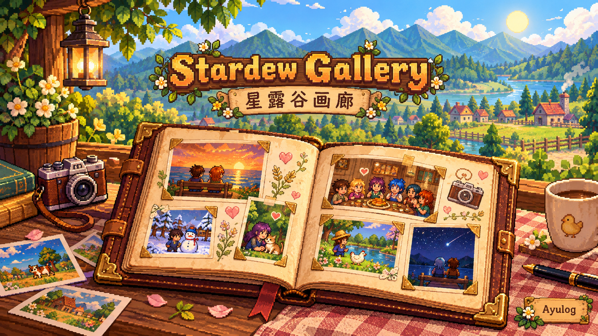
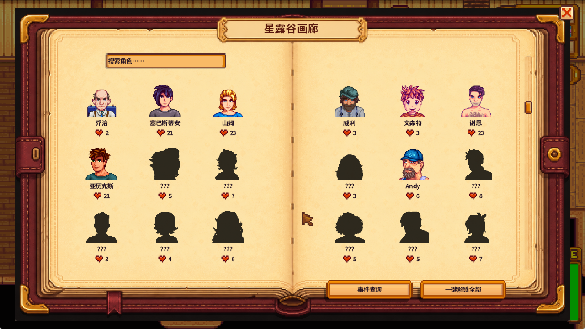
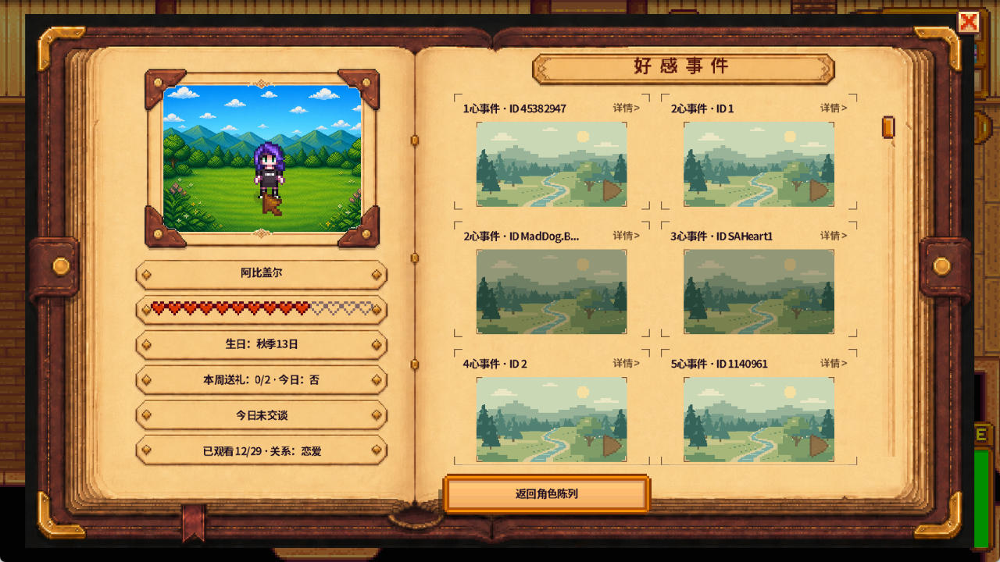
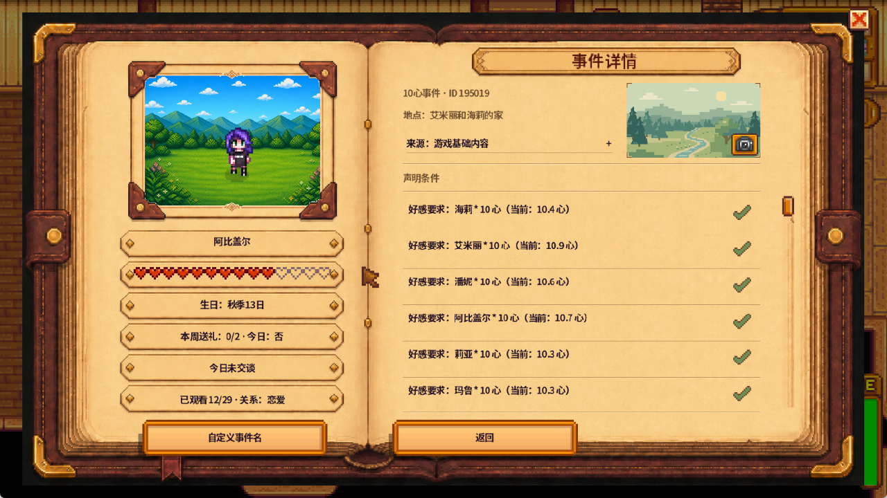
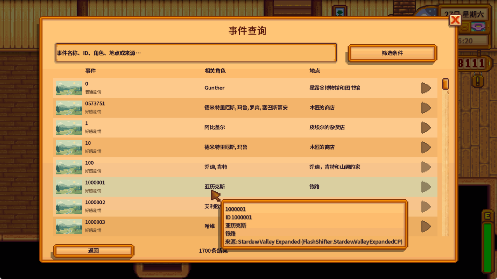

# Stardew Gallery / 星露谷画廊

[](docs/images/stardew-gallery-ai-poster.png)

*宣传插画由 AI 生成 / Promotional artwork generated with AI*

> **最新版本 2.10.0**：删除 AI 名单与运行时修改追踪，画廊不再联网；修复回放后鱼饵弹药丢失、换季清空作物、失焦误读档等存档安全问题；条件判定与游戏 1.6.15 一致；完善手柄与 Steam Deck 支持（Steam 键盘可输入中文，搜索支持拼音），来源识别支持 Linux 与链接目录。升级说明详见 [2.10.0 版本说明](docs/RELEASE_2.10.0_NOTES.md)。
>
> **Latest Release 2.10.0**: Removes the AI exclusion list and runtime modification tracking (the gallery no longer goes online), fixes replay safety issues such as lost bait and ammo, cleared crops after a season change and reloads after alt-tabbing, matches Stardew Valley 1.6.15 condition checks, and improves controller, Steam Deck (Chinese input through Steam's keyboard, pinyin search), Linux and linked-folder support. See the [2.10.0 Release Notes](docs/RELEASE_2.10.0_NOTES.md) for update instructions.

Copyright (C) 2026 Ayulog. Licensed under the GNU General Public License v3.0.

[中文说明](#中文) · [English](#english) · [下载 / Download 2.10.0](https://github.com/Ayulog/Stardew-Gallery/releases/tag/v2.10.0) · [更新日志 / Changelog](CHANGELOG.md)

---

## 画廊预览 / Gallery Preview

按角色收藏好感剧情，直观查看触发条件与模组来源，随时安全重温经历过的故事。  
Browse heart events by character, check trigger conditions and mod sources in plain language, and safely replay your favorite scenes.

| 角色画廊 / Character Gallery | 好感相册 / Heart Event Album |
| --- | --- |
| [](docs/images/gallery-overview.png) | [](docs/images/character-album.png) |
| **条件与来源 / Conditions & Sources** | **事件查询 / Event Search** |
| [](docs/images/event-details.png) | [](docs/images/event-query.png) |

*点击图片可查看大图。截图环境安装了额外的内容扩展与美化模组。 / Click any image to view full size. Screenshots were taken with additional expansion and cosmetic mods installed.*

---

## 中文

**星露谷画廊（Stardew Gallery）** 是一款游戏内剧情图鉴与回放工具。无论你想重温某位村民的爱心事件、弄清下一段剧情为什么迟迟不触发，还是在安装了大量扩展 Mod 后查找某个事件究竟来自哪里，都可以在画廊中直接翻阅。

### 核心功能

- **角色好感相册**
  - 自动整理当前游戏与已安装扩展 Mod 中生效的 NPC 好感事件，按角色分册展示。
  - 支持为事件设置好记的**自定义名称**并用于搜索（原始事件 ID 依然保留，名称配置跨本机存档共用）。
- **直观的触发条件与前置跳转**
  - 将复杂的事件脚本条件（好感心数、已看事件、信件、季节、日期、时间、金钱、背包物品、社区中心进度等）转化为易读的文字清单，并标出当前存档“已满足”或“尚缺”哪一步。
  - 判定与游戏 1.6.15 一致，包括游戏自身的特殊行为（例如一个条件写多个季节时只检查第一个，说明里会标出被忽略的季节）。
  - 点击条件中的前置事件 ID 可直接跳转到对应事件详情；无法静态判定的特殊或第三方条件会如实标为“未知”，不会误导进度。
- **安全回放与演出控制**
  - 已触发过的事件可直接点击重温；也可开启“**一键解锁全部**”在画廊中临时开放所有可回放剧情（仅改变画廊内的浏览权限，绝不修改存档真实好感度或事件进度）。
  - 回放时自动切入事件所需的季节画面、时间与原版天气，并在回放结束、跳过或异常退出时恢复玩家原本的位置、时间与状态；回放期间禁止保存，不会触发真实事件。
  - 支持 **1x / 2x / 4x 倍速**；可在 GMCM 开启普通对话自动推进，只在 2x / 4x 下生效，遇到剧情选项时停下等待玩家选择。
- **纯净剧照抓拍与封面管理**
  - 回放途中可随时抓拍不含对话框和 HUD 的画面，保存在本地的 `event-photos/` 目录中。
  - 支持将抓拍的剧照设为相册与详情页的事件封面，随时替换或恢复默认。
- **全局事件查询与来源追溯**
  - 除角色主相册外，提供独立的**事件查询器**，支持按名称、ID、角色、地点、来源模组、类型和进度组合筛选；具体条件在详情页查看。
  - 详情页直接显示事件的**原始来源**（原版或具体的 Content Patcher / AliveNpcs 模组及定义文件），方便排查剧情出处。
- **外观适配与多语言支持**
  - 自动读取当前生效的 Content Patcher 肖像与行走图，并兼容 **Portraiture**、**DDFC**、**Scale Up Unofficial** 等高清/动态立绘框架。
  - 键鼠与手柄同等支持；Steam Deck 和 Steam 大屏幕模式下用 Steam 键盘输入，可以打中文。内置全部 12 种游戏官方语言，界面随窗口分辨率与 UI 缩放自适应调整。

#### 事件分类说明

画廊将当前可识别的地图事件分为三类（纯过场转换与内部逻辑会被自动过滤）：

| 类型 | 查看位置 | 回放规则 |
| --- | --- | --- |
| **好感剧情** | 角色相册、事件查询 | 已在存档中经历过，或开启“一键解锁全部” |
| **普通剧情** | 事件查询 | 需先在 GMCM 开启“普通事件回放”（默认关闭）；未经历过的同样需开启“一键解锁” |
| **前置事件** | 事件查询、条件前置链接 | 仅作为解锁标记参考（展示触发条件、时机、当前获得状态与关联剧情），不提供回放 |

### 安装与可选配置

1. 确保已安装 **Stardew Valley 1.6.15+** 与 **SMAPI 4.5.2+**。
2. 下载并解压压缩包，将 `StardewGallery` 文件夹放入游戏的 `Mods` 目录。
3. 通过 SMAPI 启动游戏。

**可选依赖：**
- **Generic Mod Config Menu (GMCM)**：安装后可在游戏设置菜单中直接配置快捷键、普通事件回放、对话自动推进和回滚提示。未安装时也可直接编辑模组目录下的 `config.json`。
- **角色美化框架**：无需为了画廊专门安装任何美化前置。若已安装 Portraiture，请先在正常游戏对话中确认立绘包已切换生效，画廊即会同步读取；加载异常时会自动回退到普通肖像或默认占位图标。

### 从旧版本更新

更新前请退出游戏并备份原 `Mods/StardewGallery` 文件夹。建议**先删除旧版模组文件夹，将新版解压为干净的 `StardewGallery` 目录**（以清理旧版本遗留的文件），再将以下个人数据拷回。旧版的 AI 名单与来源追踪设置在 2.10.0 中不再使用，会被忽略。

| 文件 / 目录 | 说明 |
| --- | --- |
| `config.json` | 快捷键与模组设置 |
| `event-photos/` | 各存档抓拍的回放剧照与自定义封面 |
| `user-data/` | 跨存档共用的自定义事件名称 |

### 操作指南

- **打开画廊**：默认按 `G` 键；或打开游戏菜单的“收藏”页，点击左侧标签下方的画廊按钮（手柄选中后按 `A`）。
- **浏览与查询**：画廊首页搜索框用于快速定位角色，中文界面可直接输入拼音（如 `abge` 找到阿比盖尔），按回车先列出候选，再按回车或 `A` 进入；点击右下角“事件查询”可进入全局搜索与多条件筛选面板（手柄按 `Y` 打开筛选，肩键翻页，`B` 返回上一级）。
- **倍速与抓拍**：回放时点击右上角按钮或按快捷键（手柄默认右肩键 RB）切换 `1x / 2x / 4x` 倍速；按 `F8`、手柄左肩键（LB）或点击相机图标即可抓拍无 UI 剧照，并在事件详情页点击缩略图管理封面。
- **卸载模组**：直接删除 `Mods/StardewGallery` 文件夹即可（如需留存剧照与自定义命名，请提前备份 `event-photos/` 与 `user-data/`）。

### 来源追溯说明

- **查看事件来源**：事件详情页“地点”下方会显示该事件的原始提供者（原版、具体 Content Patcher 内容包或 AliveNpcs 场景包），点击即可查看匹配的定义文件路径。画廊在首次打开目录时自动扫描已加载模组的文件建立索引，无需额外配置，也不联网。
- **其他声明者**：同一事件还被其他包声明时，会单独列出这些包，并注明它们不一定在当前存档生效。
- **证据不完整**：如果原始包的文件没能完整读取，只找到覆盖包时会显示“证据不完整”，不会把覆盖包当作原作者。
- **平台与部署**：在 Linux / Steam Deck 上，文件名大小写与引用不一致时同样能识别（与 SMAPI 一致）；通过 Stardrop 等工具以链接目录部署的模组也能识别。
- 来源只用于显示和查询，不影响收录、解锁与回放。

### 兼容性与已知限制

- **仅限单人模式**：事件回放仅支持单人游戏。联机和分屏下可以浏览画廊，但不能回放；联机农场工的“一键解锁”只在本次会话生效。
- **基于当前状态**：画廊目录与回放均基于当前存档状态及当前生效的模组内容动态解析。未满足 Content Patcher `When` 加载条件的分支、节日主流程、婚礼仪式、夜间特殊结算（`FarmEvent`）、影院放映及纯 C# 编写的自定义事件不在收录范围内。
- **存档与第三方保护边界**：回放快照会保护并恢复原版状态与奖励（位置、时间、金钱、背包、好感、信件、已看记录、任务、配方、技能经验、Buff、统计、已听歌曲、已访问地点、已运行的 TriggerAction、壁炉和爷爷评价蜡烛等），但如果第三方模组通过自定义事件命令改写了外部文件或私有状态，则超出原版快照的恢复范围。
- **回放前备份**：每次回放前会把当前存档复制到 `%AppData%/StardewValley/StardewGallery/backups/<存档名>/<时间>`（Linux / macOS 为 `~/.config/StardewValley/StardewGallery/...`）。回放正常结束后删除这份备份；只有恢复失败时才会用它读档，并保留最近两份旧备份。

### 构建与开发检查

从源码构建需要 **.NET 8 SDK** 以及安装了 SMAPI 的游戏目录（项目目标框架仍为 `net6.0`）；运行独立检查程序还需安装 **.NET 6 Runtime**。详细说明见 [BUILDING.md](BUILDING.md)。

```sh
# 编译 Release 版本（请将 GamePath 替换为实际游戏安装路径）
dotnet build StardewGallery.csproj -c Release -p:GamePath="/path/to/Stardew Valley"

# 运行不依赖游戏本体的逻辑与存储检查
dotnet run --project Checks/StardewGallery.Checks.csproj -c Release
dotnet run --project PersistenceChecks/StardewGallery.PersistenceChecks.csproj -c Release
```

Windows 上可用一条命令依次运行构建、两套检查、SMAPI 运行时检查和打包：`pwsh tools/Verify-Local.ps1 -GamePath "<游戏目录>"`。2.10.0 的验证情况见 [2.10.0 版本说明](docs/RELEASE_2.10.0_NOTES.md)，待实机验收的场景见 [验收清单](docs/RELEASE_2.10.0_ACCEPTANCE.md)。

### 许可证

本项目基于 GNU General Public License v3.0 开源，完整条款见 [`LICENSE`](LICENSE)。

---

## English

**Stardew Gallery** is an in-game story album and event lookup tool for Stardew Valley. Whether you want to revisit a villager's heart events, figure out why the next cutscene hasn't triggered yet, or see which expansion mod added a specific story, you can browse and replay them right from a book-style menu.

### Key Features

- **Character Heart Albums**
  - Browse active NPC heart events from both the base game and installed expansion mods, organized into individual character albums.
  - Give events custom, memorable names and search by them while keeping original event IDs intact (shared across local saves in `user-data/`).
- **Plain-Language Conditions & Prerequisite Links**
  - Translates raw event preconditions (hearts, seen events, mail, season, date, time, money, inventory, community progress, etc.) into readable checklists showing what your save currently meets or is missing.
  - Results match Stardew Valley 1.6.15, including the game's own quirks (for example, only the first of several listed seasons counts, and the ignored seasons are named).
  - Click prerequisite event IDs to jump straight to their details. Unparseable or third-party conditions are clearly marked as unknown rather than guessed.
- **Safe Replay & Playback Controls**
  - Replay any event you have already seen, or toggle **Unlock All** to temporarily open all replayable stories in the gallery (this only affects gallery access and never modifies your actual save friendship or event progress).
  - Replays automatically set up the required seasonal look, time, and vanilla weather, then restore your original position, time, and state when the scene ends or is skipped. Saving is blocked and real events don't trigger during replay.
  - Cycle playback speed between **1x, 2x, and 4x**. Optional dialogue auto-advance (GMCM) works at 2x and 4x; player choices always pause and wait for your input.
- **Clean Scene Photos & Custom Covers**
  - Capture HUD-free, dialogue-free screenshots during replay and set your favorite shot as the event's album cover. Photos are stored per save in `event-photos/`.
- **Global Event Search & Mod Source Lookup**
  - A dedicated **Event Search** lets you find ordinary stories and prerequisite markers by name, ID, character, location, mod source, category, and progress. Conditions are shown on the detail page.
  - Event details display the **original provider** (base game or a specific Content Patcher / AliveNpcs mod and its definition file) right below the location.
- **Cosmetic Compatibility & Full Localization**
  - Automatically displays active Content Patcher portraits and sprites, with built-in support for **Portraiture**, **DDFC**, and **Scale Up Unofficial**.
  - Keyboard, mouse, and controller are equally supported. On Steam Deck and in Steam Big Picture mode, text fields use Steam's keyboard, which can type Chinese. Includes adaptive UI scaling and translations for all 12 official game languages.

#### Event Categories

The gallery organizes discoverable location events into three categories (pure movement transitions and internal scripts are filtered out):

| Category | Where to Find | Replay Rules |
| --- | --- | --- |
| **Heart Stories** | Character Albums & Event Search | Replayable once seen in your save, or with **Unlock All** enabled |
| **Ordinary Stories** | Event Search | Enable **Ordinary Event Replay** in GMCM first (off by default); unseen stories also require **Unlock All** |
| **Prerequisite Events** | Event Search & Prerequisite Links | Reference only (shows unlock conditions, trigger timing, progress, and linked stories); not replayable |

### Installation & Optional Dependencies

1. Install **Stardew Valley 1.6.15+** and **SMAPI 4.5.2+**.
2. Extract the archive and place the `StardewGallery` folder into your `Mods` directory.
3. Launch the game through SMAPI.

**Optional Mods:**
- **Generic Mod Config Menu (GMCM)**: Configure keybinds, ordinary event replay, dialogue auto-advance, and the rollback warning in-game. Without GMCM, you can edit `config.json` directly.
- **Cosmetic Frameworks**: None are required to use the gallery. For Portraiture packs, make sure the portrait pack is active in normal game dialogue first; if an image fails to load, the gallery falls back to standard portraits or a placeholder icon.

### Updating from Older Versions

Close the game and back up `Mods/StardewGallery`. We recommend **extracting the new version into a clean `StardewGallery` folder** (so files from older versions are removed) and copying back your player data. The old AI list and source tracking settings are no longer used in 2.10.0 and are ignored.

| File / Folder | Purpose |
| --- | --- |
| `config.json` | Keybinds and mod settings |
| `event-photos/` | Replay screenshots and custom covers for each save |
| `user-data/` | Custom event names shared across local saves |

### Controls & Usage

- **Open the Gallery**: Press `G` (default), or open the game menu's Collections page and click the gallery button below the side tabs (on a controller, select it and press `A`).
- **Browse & Filter**: The home search bar filters characters; in Chinese it also takes pinyin (for example `abge` finds 阿比盖尔). Enter lists the matches, and a second Enter or `A` opens one. Click **Event Search** in the bottom-right corner to search across all events and open the filter panel (on a controller, press `Y` for filters, shoulder buttons to page, and `B` to go back).
- **Speed & Screenshots**: During replay, use the top-right button or hotkey (Right Shoulder on a controller by default) to cycle `1x / 2x / 4x`. Press `F8`, the controller's Left Shoulder button, or the camera icon to take a clean screenshot, then click the thumbnail on the event detail page to manage covers.
- **Uninstall**: Delete `Mods/StardewGallery` (keep `event-photos/` and `user-data/` if you want to save your screenshots and custom event names).

### Event Sources

- **Original Source Lookup**: Event details show which mod (or vanilla XNB) defines each event and which file it comes from, by scanning loaded Content Patcher and AliveNpcs files when the catalog is first opened. Nothing is downloaded.
- **Also Declared By**: Other packs declaring the same event are listed separately, noting they may not be active in your save.
- **Evidence Incomplete**: If the original pack's files couldn't all be read and only an override was found, the source says so instead of naming the override as the original author.
- **Platforms & Deployment**: On Linux and Steam Deck, file references that differ in letter case are matched like SMAPI does; mods deployed as linked folders (Stardrop and similar) are supported.
- Sources are for display and search only; they never affect what is listed, unlocked, or replayable.

### Compatibility & Limitations

- **Single-Player Only**: Event replay works in single-player only. In multiplayer and split-screen you can browse the gallery but not replay; a farmhand's Unlock All lasts for the current session only.
- **Current-State Catalog**: Both the catalog and replays reflect your current save state and currently active mod patches. Inactive Content Patcher branches, main festival flows, wedding ceremonies, overnight `FarmEvent` scenes, movie screenings, and pure C# custom events are not included.
- **Save Protection Scope**: Replays snapshot and restore native player state and rewards (position, time, money, inventory, friendship, mail, seen event IDs, quests, recipes, skill experience, buffs, stats, songs heard, visited locations, trigger actions run, fireplaces, Grandpa's evaluation candles, etc.), but cannot roll back external files or private state modified by third-party custom event commands.
- **Pre-Replay Backup**: Before each replay the current save is copied to `%AppData%/StardewValley/StardewGallery/backups/<save>/<time>` (`~/.config/StardewValley/StardewGallery/...` on Linux and macOS). The copy is deleted when the replay ends normally; it is only reloaded if restoring fails, and the two most recent older backups are kept.

### Building & Validation

Building from source requires the **.NET 8 SDK** and a game installation with SMAPI (the project targets `net6.0`). Running the standalone check suites also requires the **.NET 6 Runtime**. See [BUILDING.md](BUILDING.md) for full details.

```sh
# Build Release (replace GamePath with your Stardew Valley folder)
dotnet build StardewGallery.csproj -c Release -p:GamePath="/path/to/Stardew Valley"

# Run standalone logic and persistence checks
dotnet run --project Checks/StardewGallery.Checks.csproj -c Release
dotnet run --project PersistenceChecks/StardewGallery.PersistenceChecks.csproj -c Release
```

On Windows, one command runs the build, both check suites, the SMAPI runtime checks, and packaging: `pwsh tools/Verify-Local.ps1 -GamePath "<game folder>"`. For 2.10.0 validation, see the [2.10.0 Release Notes](docs/RELEASE_2.10.0_NOTES.md); scenes still awaiting in-game acceptance are listed in the [acceptance checklist](docs/RELEASE_2.10.0_ACCEPTANCE.md).

### License

This project is licensed under the GNU General Public License v3.0. See [`LICENSE`](LICENSE) for the full terms.
