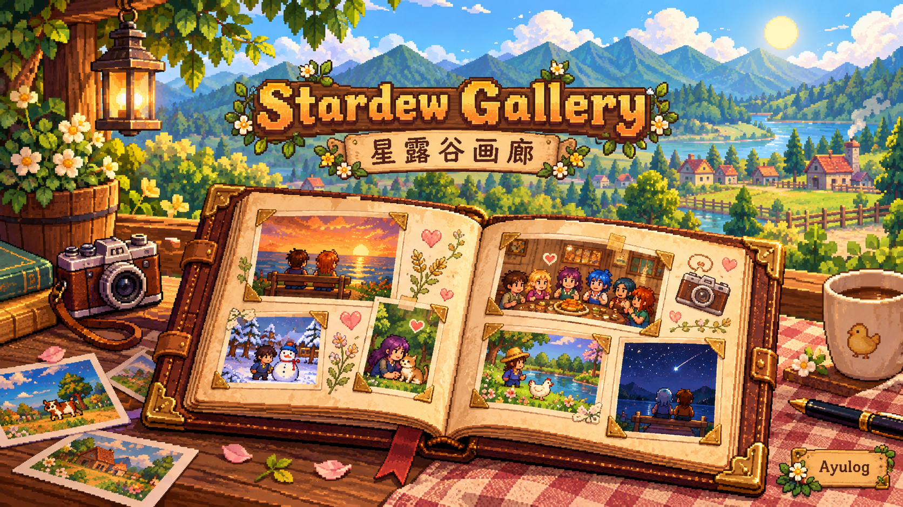
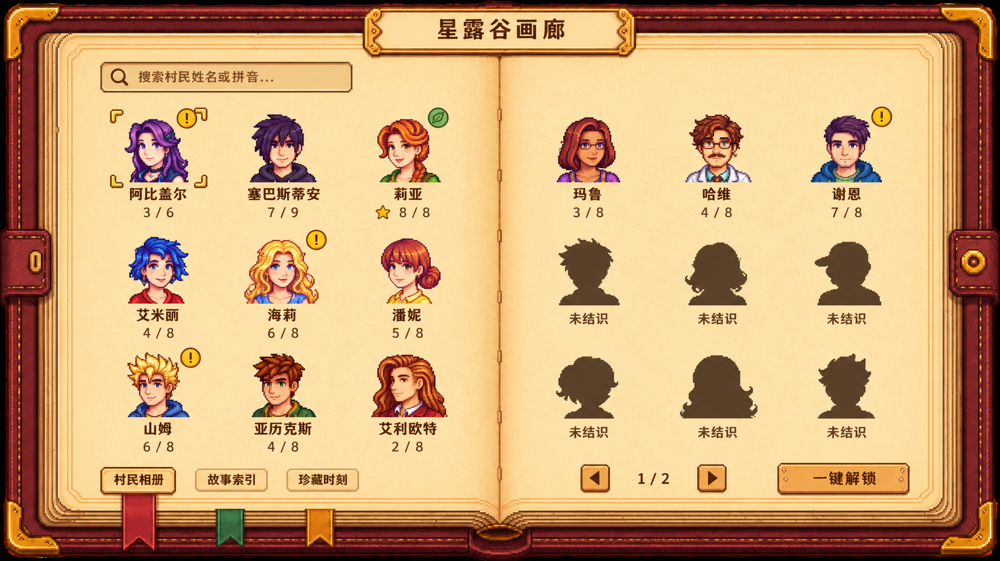
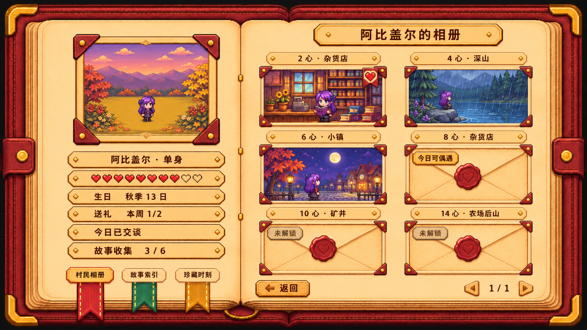
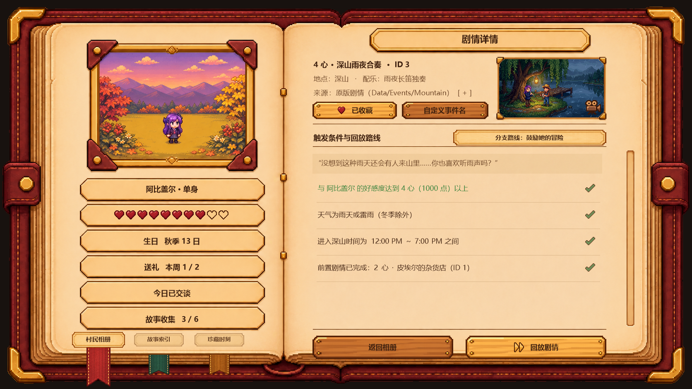
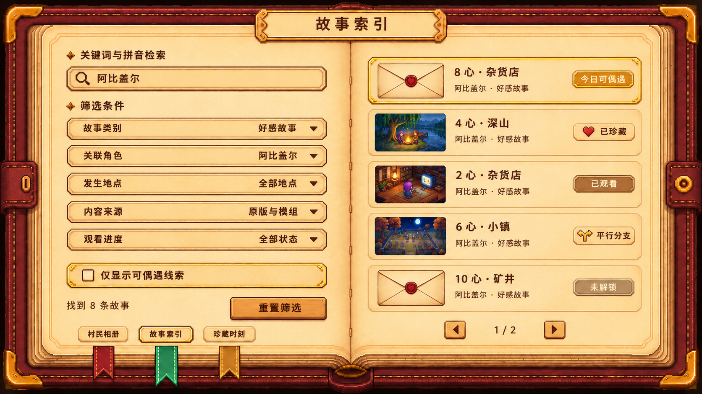

# Stardew Gallery / 星露谷画廊

[](docs/images/stardew-gallery-ai-poster.png)

*宣传插画由 AI 生成 / Promotional artwork generated with AI*

> **最新发布版本 2.10.0**：删除 AI 名单与运行时修改追踪，画廊不再联网；修复回放后鱼饵弹药丢失、换季清空作物、失焦误读档等存档安全问题；条件判定与游戏 1.6.15 一致；完善手柄与 Steam Deck 支持（Steam 键盘可输入中文，搜索支持拼音），来源识别支持 Linux 与链接目录。升级说明详见 [2.10.0 版本说明](docs/RELEASE_2.10.0_NOTES.md)。
>
> **Latest Release 2.10.0**: Removes the AI exclusion list and runtime modification tracking (the gallery no longer goes online), fixes replay safety issues such as lost bait and ammo, cleared crops after a season change and reloads after alt-tabbing, matches Stardew Valley 1.6.15 condition checks, and improves controller, Steam Deck (Chinese input through Steam's keyboard, pinyin search), Linux and linked-folder support. See the [2.10.0 Release Notes](docs/RELEASE_2.10.0_NOTES.md) for update instructions.

Copyright (C) 2026 Ayulog. Licensed under the GNU General Public License v3.0.

[中文说明](#中文) · [English](#english) · [下载 / Download 2.10.0](https://github.com/Ayulog/Stardew-Gallery/releases/tag/v2.10.0) · [更新日志 / Changelog](CHANGELOG.md)

---

## 画廊预览 / Gallery Preview

翻阅皮质回忆手账，直观查看触发条件、可偶遇线索与模组来源，珍藏婚礼与剧情剧照并安全重温故事。  
Flip through a leather-bound story journal, inspect plain-language conditions, encounter clues, and mod sources, cherish wedding & scene Polaroids, and safely replay your favorite cutscenes.

| 角色画廊 / Character Gallery | 好感相册 / Heart Event Album |
| --- | --- |
| [](docs/images/gallery-overview.png) | [](docs/images/character-album.png) |
| **条件与来源 / Conditions & Sources** | **事件查询 / Event Search** |
| [](docs/images/event-details.png) | [](docs/images/event-query.png) |

*点击图片可查看大图。截图环境安装了额外的内容扩展与美化模组。 / Click any image to view full size. Screenshots were taken with additional expansion and cosmetic mods installed.*

---

## 中文

**星露谷画廊（Stardew Gallery）** 是一款皮质手账风格的游戏内剧情图鉴、回忆留影与安全回放工具。无论你想重温某位村民的爱心故事与平行分支、通过“可偶遇”线索了解今天去哪里能触发新剧情，还是在安装了大量扩展 Mod 后排查某段剧情究竟来自哪个模组，都可以在同一本手账中轻松翻阅。

### 核心功能

- **皮质手账三书签与拟真翻页**
  - 全流程统一承载于摊开的皮质手账大书，左下悬挂三枚彩色丝带书签随时切换：**村民相册**、**故事索引**与**珍藏时刻**。
  - 主书页采用左右**整页拟真翻书**（支持点击折角翻页箭头、鼠标滚轮、`PageUp` / `PageDown` 与手柄肩键 `LB` / `RB`，配翻书音效），自动记住所在页码与焦点。
- **村民相册、满收集金星与双级“可偶遇”线索**
  - 自动整理原版与扩展 Mod 的 NPC 好感故事；首页显示清晰的 `已收 / 总数` 故事节点进度（前序互斥的平行路线算作同一节点，单周目不卡满收集），集齐后点亮**星露谷原生金星徽章**。
  - 提供**今日可偶遇**（长期条件及当日季节、星期、天气均已吻合，仅待合适时间前往现场）与**线索就绪**（长期条件已满足，等待季节/星期/天气）双级徽章提示，支持可选的**每日清晨偶遇轻提示**、**原版社交页偶遇角标**（悬停提示、点击直达相册），并在故事索引提供内嵌手账下拉筛选与一键快捷筛选。
  - 角色相册左页配备随**四季、昼夜与雨/雪/绿雨天气**动态变化的景窗与**平缓左右草地漫步＋面向玩家待机**小人；卡片默认采用 `心数/关系阶段 · 地点` 命名（支持自定义名称），未真实经历的无封面故事呈现**羊皮纸火漆信封**卡面（区分“未观看”与“未解锁”），已解锁故事自动提取主角首句**代表台词签注**（未解锁严防剧透）。
- **直观的 1.6.15 条件清单与前置跳转**
  - 覆盖 41 种原版传统事件前置（含 `a X Y` 入口格坐标展示）及 **Stardew Valley 1.6.15 纯只读确定性内置 `GameStateQuery`（GSQ）**（支持带引号参数与递归 `ANY` / `!ANY` 复合子句），逐条标出“已满足 / 未满足 / 无法判断”，与游戏原生判定保持一致。
  - 点击条件中的前置事件或 `Data/TriggerActions` 标记可直接多级跳转查看详情并按原路径返回；随机或第三方自定义查询如实标为未知，绝不执行外部动作探测。
- **安全回放、分支（If 线）鉴赏与剧场控制**
  - 支持回放已经历的好感故事；当同一角色的互斥平行事件已真实经历其中一条时，同组错过的路线自动作为**平行分支（If 线）**开放安全鉴赏（不写入真实 `eventsSeen`）；也可开启“**一键解锁全部**”临时浏览全部可回放内容。
  - 回放期间自动切入所需的季节画面、时间与原版天气（含从正向 GSQ 条件提取），临时遮蔽本事件已答过的内联 `$q` 选项以便重温不同对话回应，并支持在详情页切换同事件 **`fork` 子分支路线**；结束、跳过或中断后完整恢复回放前状态并禁止回放中保存。
  - 支持 **1x / 2x / 4x 倍速**、可选普通对话自动推进（遇选项自动停下）、无操作**自动淡出控制条**、过场**配乐（BGM）曲名显示**，以及一键**暂停并隐藏对话框定格观景**（期间仍可按截图键抓拍）。
- **静默自动留影、婚礼留念卡与珍藏时刻**
  - 默认开启**静默自动留念**（可在 GMCM 关闭）：在正常游玩自然触发尚未留存照片的剧情、村民婚礼或首次回放无封面故事时，待画面稳定后静默生成首张无 UI 剧照设为初始封面（不播快门声、不弹提示条）。
  - 与村民举行婚礼时自动生成置顶的**婚礼留念卡**（记录结婚年月日，仅作留影珍藏不提供回放，也不计入未婚角色分母）；在详情页可将喜爱的故事加入收藏，跨角色汇聚于**珍藏时刻**书签页；桌面端剧照页支持一键**打开本地文件夹**。
- **静态来源追溯、外观兼容与社交页直达**
  - 详情页与前置页直接展示**静态定义来源**（涵盖 `Data/Events`、`Data/TriggerActions` 规则及 `fork` / `switchEvent` 分支子脚本的原版或 CP / AliveNpcs 提供者与其他声明者）。
  - 自动兼容 Content Patcher、**Portraiture**、**DDFC**、**HD Portraits** 与 **Scale Up Unofficial**；在原版游戏菜单“**社交**”页将鼠标悬停或手柄聚焦于村民并按画廊键（默认 `G`），即可直达该村民相册，按返回键无缝回到原社交页位置与焦点。
  - 键鼠、手柄与 Steam Deck 同等支持（Steam 屏幕键盘支持中文输入，中文界面搜索支持全拼/首字母拼音），内置全部 12 种官方语言。

#### 条目分类说明

画廊将当前可识别的故事与纪念条目整理如下（纯过场转换与内部逻辑会自动过滤）：

| 类型 | 查看位置 | 回放规则 |
| --- | --- | --- |
| **好感剧情** | 村民相册、故事索引、珍藏时刻（收藏后） | 已在存档中经历过、属于已开放的平行分支（If 线），或开启“一键解锁全部” |
| **普通剧情** | 故事索引、珍藏时刻（收藏后） | 需先在 GMCM 开启“普通事件回放”（默认关闭）；未经历过的同样需开启“一键解锁” |
| **前置事件** | 故事索引、条件前置链接 | 仅作解锁标记与规则来源参考（展示触发条件、时机、获得状态与关联剧情），不提供回放 |
| **婚礼留念卡** | 配偶个人相册置顶、珍藏时刻 | 当前存档婚礼留影珍藏，点击查看全尺寸照片，不提供状态机回放 |

### 安装与可选配置

1. 确保已安装 **Stardew Valley 1.6.15+** 与 **SMAPI 4.5.2+**。
2. 下载并解压压缩包，将 `StardewGallery` 文件夹放入游戏的 `Mods` 目录。
3. 通过 SMAPI 启动游戏。

**可选依赖：**
- **Generic Mod Config Menu (GMCM)**：安装后可在游戏设置菜单中直接配置打开画廊键、倍速键、截图键、暂停观景键、静默自动留念、每日清晨偶遇轻提示、原版社交页偶遇角标、普通事件回放、对话自动推进、回档风险提示与调试诊断。未安装时也可直接编辑模组目录下的 `config.json`。
- **角色美化框架**：无需为了画廊专门安装任何美化前置。已安装 Portraiture、DDFC、HD Portraits 或 Scale Up 时画廊会自动按只读方式适配；加载异常时会自动回退到普通肖像或默认占位图标。

### 从旧版本更新

更新前请退出游戏并备份原 `Mods/StardewGallery` 文件夹。建议**先删除旧版模组文件夹，将新版解压为干净的 `StardewGallery` 目录**（以清理旧版本遗留的文件），再将以下个人数据拷回。旧版的 AI 名单与来源追踪设置在 2.10.0 起不再使用，会被忽略。

| 文件 / 目录 | 说明 |
| --- | --- |
| `config.json` | 快捷键与模组设置 |
| `event-photos/` | 各存档自动定格或手动抓拍的剧照、婚礼留念与自定义封面 |
| `user-data/` | 跨本机存档共用的自定义事件名称（`event-names.json`）与收藏剧情标记（`favorite-events.json`） |

### 操作指南

- **打开画廊與社交页直达**：平时按 `G` 键，或打开游戏菜单“收藏”页点击左侧标签下方的画廊图标；在游戏菜单“**社交**”页指向某位已认识村民时按 `G` 可直达其个人相册，按 `B` / `Esc` 无缝返回原社交页。
- **书签切换与翻书**：点击左下三枚彩色书签（或用手柄方向键移至左下书签按 `A`）切换“村民相册 / 故事索引 / 珍藏时刻”；使用底部翻页箭头、滚轮、`PageUp` / `PageDown` 或手柄 `LB` / `RB` 整页翻阅。搜索框按回车先列出候选并聚焦首项，再按回车或 `A` 打开。
- **剧场控制与留影**：回放时按倍速键（手柄默认 `RB`）切换 `1x / 2x / 4x`；按暂停观景键（默认键盘 `H` 或手柄右摇杆按下）暂停推进并隐藏对话框与控制条；按 `F8`、手柄 `LB` 或点击相机图标手动抓拍无 UI 剧照，在详情页点击缩略图管理封面或打开本地目录。
- **卸载模组**：直接删除 `Mods/StardewGallery` 文件夹即可（完全不污染存档资产；如需留存剧照、自定义命名与收藏记录，请提前备份 `event-photos/` 与 `user-data/`）。

### 来源追溯说明

- **查看定义来源**：事件详情页“地点”下方与前置事件详情页会显示原始提供者（原版 XNB、具体 Content Patcher 内容包或 AliveNpcs 场景包），展开后可查看匹配的定义文件路径以及 `fork` / `switchEvent` 分支子脚本的声明来源。画廊在首次需要时只读扫描已加载模组文件建立缓存，无需额外配置，也不联网。
- **其他声明者与证据不完整**：同一条目还被其他包声明或修改时会单独列出；若原始包文件未能完整读取而仅见覆盖包，会如实标为“证据不完整”，绝不把覆盖包误判为原作者。
- **平台与部署**：在 Linux / Steam Deck 上支持大小写无关路径匹配；通过 Stardrop 等工具以符号链接/目录联接部署的模组同样可识别。来源仅用于展示与筛选，不影响收录、解锁与回放。

### 兼容性与已知限制

- **仅限单人回放**：事件回放仅支持单人模式。网络联机、本地分屏及联机模式运行的存档均可浏览画廊并享受自然游玩静默留影，但不可回放；联机农场工的“一键解锁”仅在本次会话生效。
- **基于当前状态**：画廊目录与回放均基于当前存档状态及当前生效的模组资产动态解析。未满足 Content Patcher `When` 加载条件的分支、节日主流程、夜间特殊结算（`FarmEvent`）、影院放映及纯 C# 自定义事件不在回放收录范围内（婚礼支持发生当下自动留影纪念，不做状态机重跑回放）。
- **存档与第三方保护边界**：回放快照会保护并恢复原版状态与奖励（位置、时间、季节与天气、金钱、背包及鱼饵弹药、好感、信件、已看记录、对话回答 ID、任务、配方、技能经验、Buff、统计、已听歌曲、已访问地点、已运行 TriggerAction、壁炉与地图作物采集物等），但第三方模组通过自定义事件命令改写的外部文件或私有状态超出原版快照恢复范围。
- **回放前备份**：每次回放前会把当前存档复制到 `%AppData%/StardewValley/StardewGallery/backups/<存档名>/<时间>`（Linux / macOS 为 `~/.config/StardewValley/StardewGallery/...`）。正常结束后自动清理本次临时备份；仅当恢复失败时才会回退读档并保留最近两份旧备份。

### 构建与开发检查

从源码构建需要 **.NET 8 SDK** 以及安装了 SMAPI 的游戏目录（项目目标框架仍为 `net6.0`）；运行独立检查程序还需安装 **.NET 6 Runtime**。详细说明见 [BUILDING.md](BUILDING.md)。

```sh
# 编译 Release 版本（请将 GamePath 替换为实际游戏安装路径）
dotnet build StardewGallery.csproj -c Release -p:GamePath="/path/to/Stardew Valley"

# 运行不依赖游戏本体的逻辑与存储检查
dotnet run --project Checks/StardewGallery.Checks.csproj -c Release
dotnet run --project PersistenceChecks/StardewGallery.PersistenceChecks.csproj -c Release
```

Windows 上可用一条命令依次运行构建、两套检查、SMAPI 运行时检查和打包：`pwsh tools/Verify-Local.ps1 -GamePath "<游戏目录>"`。2.10.0 的验证情况见 [2.10.0 版本说明](docs/RELEASE_2.10.0_NOTES.md)，待实机验收的场景见 [验收清单](docs/RELEASE_2.10.0_ACCEPTANCE.md)。

### 许可证

本项目基于 GNU General Public License v3.0 开源，完整条款见 [`LICENSE`](LICENSE)。

---

## English

**Stardew Gallery** is a leather-journal story album, memory keepsake, and safe cutscene replay mod for Stardew Valley. Whether you want to revisit a villager's heart events and missed parallel routes, spot which unseen cutscenes can be encountered today, or see which expansion mod added a specific story, everything lives inside one cohesive book spread.

### Key Features

- **Three-Bookmark Leather Journal & Whole-Page Book Turning**
  - Every view is unified inside a `1672×941` open leather journal with three pixel-art bottom-left ribbon bookmarks: **Villager Albums**, **Story Index**, and **Treasured Moments**.
  - Main spreads use whole-page book turning (click page arrows, scroll the mouse wheel, press `PageUp` / `PageDown`, or use controller `LB` / `RB` shoulder buttons with native page-flip audio), remembering your exact page and focus when navigating deeper and returning.
- **Villager Albums, Gold Stars & Two-Tier Encounter Clues**
  - Organizes base-game and modded NPC heart stories by villager; the overview displays `Collected / Total` story node progress (mutually exclusive sibling branches count as a single node so single-playthrough saves are never locked out of completion) and lights up Stardew's **native gold star** when complete.
  - Highlights unseen stories with two-tier encounter badges—**Available Today** (long-term requirements plus today's season, day, and weather all match) and **Ready for Timing** (long-term requirements met, waiting on season/day/weather)—paired with optional **Morning Encounter Hints**, **Social Tab Clue Badges** (hover for spoiler-free tips or click to jump to their album), and in-book parchment filter dropdowns plus a one-click **Encounter Clues** filter in the Story Index.
  - Character albums feature a dynamic **4-season, day/dusk/night, and rain/snow/green-rain scenic window** with gentle left-right meadow stroll + front-facing idle pauses, readable `Hearts/Stage · Location` card titles (plus custom names), parchment wax-seal envelopes for unseen stories without photos, and anti-spoiler protagonist **Story Quotes** on unlocked cards.
- **1.6.15 Plain-Language Conditions & Prerequisite Links**
  - Translates 41 legacy event preconditions (including explicit `(X, Y)` entry tile coordinates) and **Stardew Valley 1.6.15 deterministic read-only `GameStateQuery` (GSQ)** rules (including quoted arguments and recursive `ANY` / `!ANY` clauses) into clear checklists aligned with native 1.6.15 evaluation.
  - Click positive prerequisite event IDs or `Data/TriggerActions` markers to inspect multi-level dependencies and step back cleanly; random or third-party queries are honestly marked as unknown without invoking external actions.
- **Safe Replay, Parallel Branch Appreciation & Theater Controls**
  - Replay seen heart stories, enjoy **Parallel Branch (If-Route)** cutscenes automatically unlocked once you have experienced a mutually exclusive sibling route in your save (without writing to your real `eventsSeen`), or toggle **Unlock All** for temporary gallery-wide browsing.
  - Replays apply required seasonal visuals, time, and vanilla weather (extracted from both legacy preconditions and positive GSQ clauses), temporarily mask in-scene answered `$q` dialogue IDs so choices can be re-experienced, and offer an on-page **`fork` sub-route selector**—while blocking saves and restoring your exact player/world snapshot afterward.
  - Includes **1x / 2x / 4x** playback speed, optional auto-advance dialogue (pausing at choices), **auto-fading HUD controls**, readable **BGM track titles**, and a **Pause & Hide UI** scenic freeze hotkey (`H` / Right Stick click) for clean framing and screenshots.
- **Silent Auto-Memento, Wedding Mementos & Treasured Moments**
  - **Silent Auto-Memento** (on by default in GMCM) quietly captures a clean, UI-free initial cover photo when you naturally experience an uncovered story or villager wedding—or replay an uncovered scene—without shutter sound or intrusive banners.
  - Celebrated marriages create a pinned **Wedding Memento Card** in your spouse's album (recording the wedding year, season, and day for full-size photo viewing without risky state-machine replay or inflating unmarried denominators). Mark **Favorite Stories** on any detail page to gather them alongside wedding Polaroids in **Treasured Moments**, and click **Open Folder** in the photo manager on desktop OSes.
- **Static Mod Sources, Cosmetic Support & Social Tab Shortcut**
  - Inspect static providers and override declarations across `Data/Events`, `Data/TriggerActions` rules, and `fork` / `switchEvent` branch sub-scripts for vanilla XNB, Content Patcher, and AliveNpcs packs.
  - Works seamlessly with Content Patcher, **Portraiture**, **DDFC**, **HD Portraits**, and **Scale Up Unofficial**. Hover or controller-select a met villager on the vanilla **Social** tab and press `G` to jump straight into their album, then press `B` / `Esc` to return to the exact Social scroll position and focus.
  - Full keyboard/mouse, controller, and Steam Deck support (Steam on-screen keyboard Chinese input + pinyin search), localized in all 12 official game languages.

#### Entry Categories

Discoverable entries are organized into four roles (pure movement transitions and internal scripts are filtered out):

| Category | Where to Find | Replay Rules |
| --- | --- | --- |
| **Heart Stories** | Villager Albums, Story Index & Treasured Moments (when favorited) | Replayable once seen, unlocked as a sibling **Parallel Branch**, or with **Unlock All** enabled |
| **Ordinary Stories** | Story Index & Treasured Moments (when favorited) | Enable **Ordinary Event Replay** in GMCM first (off by default); unseen stories also require **Unlock All** |
| **Prerequisite Events** | Story Index & Prerequisite Links | Read-only reference (shows unlock rules, trigger timing, provider source, status, and linked stories); not replayable |
| **Wedding Memento** | Pinned in Spouse Album & Treasured Moments | Current-save wedding photo keepsake; opens full-size photo viewer, not replayable |

### Installation & Optional Dependencies

1. Install **Stardew Valley 1.6.15+** and **SMAPI 4.5.2+**.
2. Extract the archive and place the `StardewGallery` folder into your `Mods` directory.
3. Launch the game through SMAPI.

**Optional Mods:**
- **Generic Mod Config Menu (GMCM)**: Configure gallery, speed, screenshot, and scenic-pause keybinds, silent auto-memento, morning encounter hints, vanilla Social tab clue badges, ordinary event replay, dialogue auto-advance, rollback warnings, and debug diagnostics in-game. Without GMCM, edit `config.json` directly.
- **Cosmetic Frameworks**: None are required. Portraiture, DDFC, HD Portraits, and Scale Up Unofficial are supported read-only with automatic fallback to standard portraits if an asset fails to load.

### Updating from Older Versions

Close the game and back up `Mods/StardewGallery`. Extract the new version into a **clean `StardewGallery` folder** and copy back your player data below. Legacy AI list and runtime source-tracking settings are ignored since 2.10.0.

| File / Folder | Purpose |
| --- | --- |
| `config.json` | Keybinds and mod settings |
| `event-photos/` | Auto-captured and manual scene photos, wedding mementos, and custom covers per save |
| `user-data/` | Custom event names (`event-names.json`) and favorite story markers (`favorite-events.json`) shared across local saves |

### Controls & Usage

- **Open Gallery & Social Shortcut**: Press `G` (default) during gameplay, click the gallery button below the side tabs on the Collections page, or press `G` while pointing at a villager on the vanilla **Social** tab to jump directly to their album (`B` / `Esc` returns to the Social tab).
- **Bookmarks & Page Turning**: Click the three colored ribbons at the bottom-left of the book (or move down/left on a controller and press `A`) to switch between **Villager Albums**, **Story Index**, and **Treasured Moments**. Flip whole pages via the bottom arrows, mouse wheel, `PageUp` / `PageDown`, or controller `LB` / `RB`. Pressing Enter in search focuses the first match without immediately opening it.
- **Theater Controls & Photos**: During replay, cycle `1x / 2x / 4x` speed (`RB` by default), press `H` or Right Stick click to pause & hide all UI for scenic framing, and press `F8`, `LB`, or the camera button to capture clean photos. Click the detail thumbnail to manage covers or open the local folder.
- **Uninstall**: Delete `Mods/StardewGallery` (no custom furniture or save-entity assets are ever injected into your save; back up `event-photos/` and `user-data/` if you wish to keep your photos, custom names, and favorites).

### Event Sources

- **Static Source Lookup**: Event and prerequisite details display the original provider (vanilla XNB, Content Patcher pack, or AliveNpcs pack), matching definition files, and `fork` / `switchEvent` branch sub-script declarations—scanned read-only on demand with zero network access.
- **Also Declared By & Incomplete Evidence**: Additional packs declaring or editing the same entry are listed separately; if an upstream pack's files could not be fully read and only an override was seen, the status reports **Evidence Incomplete** rather than misattributing authorship.
- **Platforms & Deployment**: Supports case-insensitive path resolution on Linux / Steam Deck and symlinked/junction mod folders (such as Stardrop). Sources never restrict catalog visibility, unlocking, or replay.

### Compatibility & Limitations

- **Single-Player Replay Only**: Replays require single-player mode. Multiplayer and split-screen players can browse the gallery and capture natural-play auto-mementos, while a farmhand's Unlock All applies to the current session only.
- **Current-State Catalog**: Both the catalog and replays use your current save state and currently active mod assets. Inactive Content Patcher `When` patches, main festival flows, overnight `FarmEvent` scenes, movie screenings, and pure C# custom events are not replayable (weddings are captured live as photo mementos rather than state-machine replayed).
- **Save Protection Scope**: Snapshots protect and restore native player and location state (position, time, season & weather, money, inventory including rod bait/tackle and slingshot ammo, friendship, mail, seen events, answered dialogue IDs, quests, recipes, skill XP, buffs, stats, songs heard, visited locations, trigger actions, fireplaces, crops/forage, etc.), but cannot roll back external files or private state mutated by third-party custom event commands.
- **Pre-Replay Backup**: Before each replay the current save is backed up to `%AppData%/StardewValley/StardewGallery/backups/<save>/<time>` (`~/.config/StardewValley/StardewGallery/...` on Linux / macOS) and cleaned up after normal completion; backups are reloaded only if state restoration fails, keeping the two newest prior backups.

### Building & Validation

Building from source requires the **.NET 8 SDK** and a game installation with SMAPI (targeting `net6.0`); running standalone check suites also requires the **.NET 6 Runtime**. See [BUILDING.md](BUILDING.md) for details.

```sh
# Build Release (replace GamePath with your Stardew Valley folder)
dotnet build StardewGallery.csproj -c Release -p:GamePath="/path/to/Stardew Valley"

# Run standalone logic and persistence checks
dotnet run --project Checks/StardewGallery.Checks.csproj -c Release
dotnet run --project PersistenceChecks/StardewGallery.PersistenceChecks.csproj -c Release
```

On Windows, one command runs the build, both check suites, SMAPI runtime checks, and packaging: `pwsh tools/Verify-Local.ps1 -GamePath "<game folder>"`. For 2.10.0 validation, see the [2.10.0 Release Notes](docs/RELEASE_2.10.0_NOTES.md); scenes awaiting in-game acceptance are listed in the [acceptance checklist](docs/RELEASE_2.10.0_ACCEPTANCE.md).

### License

This project is licensed under the GNU General Public License v3.0. See [`LICENSE`](LICENSE) for the full terms.
